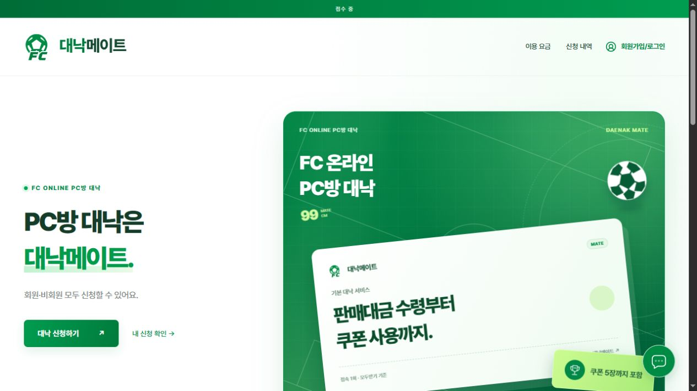
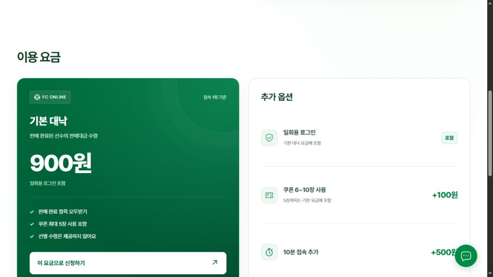
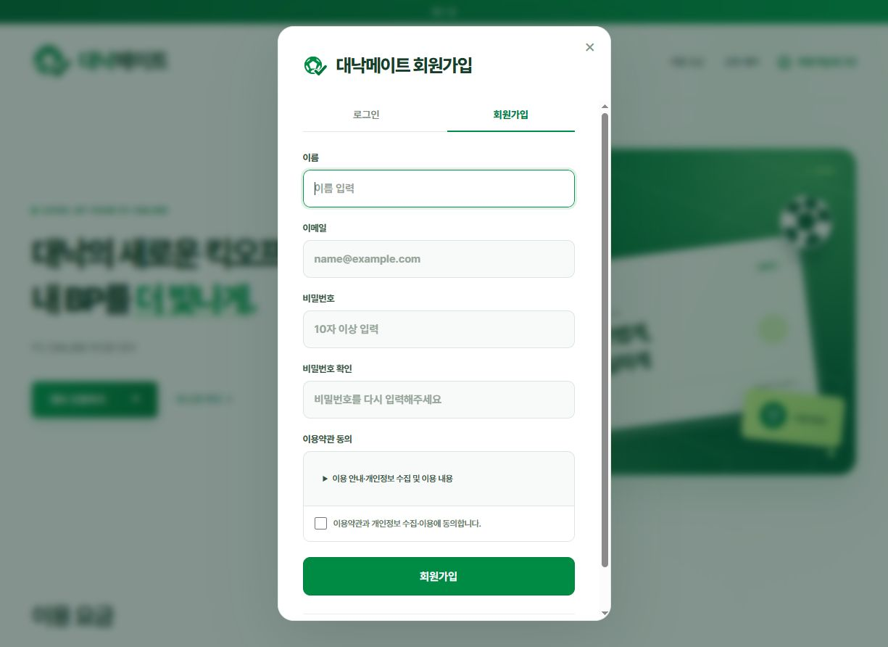

<div align="center">
  
  <h1>Daenakmate</h1>
  <p><strong>FC ONLINE PC방 대낙 신청 · 회원 관리 · 운영 관리</strong></p>
  <p>
    
    
    
    
  </p>
  <p><a href="https://nakchal-mate-demo.handyflame.chatgpt.site/">라이브 서비스</a> · <a href="#빠른-시작">로컬 실행</a> · <a href="docs/OPERATIONS.md">운영 안내</a> · <a href="docs/SECURITY.md">보안 설계</a></p>
</div>



## 프로젝트 소개

대낙메이트는 FC ONLINE 대낙을 회원 또는 비회원으로 신청하고, 운영자가 입금 확인부터 담당자 배정과 처리 상태까지 관리하는 웹 서비스입니다. 화이트·그린 컬러, Pretendard, 축구공과 FC를 결합한 벡터 로고를 사용합니다.

이 저장소에는 현재 사이트의 프런트엔드, API, 데이터베이스 마이그레이션, 테스트와 브랜드 자산이 들어 있습니다. 실제 주문·회원 데이터, 로컬 DB, 인증 토큰, 호스팅 프로젝트 식별 설정은 포함하지 않습니다.

## 주요 기능

| 영역 | 구현 내용 |
| --- | --- |
| 신청 | 회원·비회원 선택, 서비스·쿠폰 옵션, 요청사항, 입금자명, 연락처 자동 하이픈 |
| 회원 | 이메일·비밀번호 가입/로그인, 자동로그인, 약관 펼침, 신청 내역 조회 |
| 비회원 | 주문번호와 조회 비밀번호로 본인 주문 확인 |
| 운영 | 입금 확인, 담당자 배정, 신청 상태 변경, 회원별 신청 내역, 운영 설정 |
| 결제 | 계좌이체 안내와 고객 입금 알림, 운영자의 수동 입금 확인 |
| 게임 계정 | 별도 입력 구역, 아이디·비밀번호·2차 비밀번호, OTP 사용 여부 |
| 보안 전달 | 고객·담당자 브라우저 사이 WebRTC 암호화 일회성 전송 |
| 챗봇 | 요금·신청 후 진행·취소환불·고객센터를 안내하는 규칙 기반 FAQ |
| 디자인 | FC 로고, 축구장·카드 애니메이션, 요금 카드, 반응형 화면 |

### 화면 미리보기

| 이용요금 | 회원가입 |
| --- | --- |
|  |  |

## 빠른 시작

**필요 환경:** Node.js 22 이상, Python 3 (`python` 명령으로 실행 가능). 테스트와 로컬 서버는 Python 표준 라이브러리의 SQLite를 사용합니다. 별도 npm 의존성은 없습니다.

```bash
# 새로 받은 저장소 폴더에서 실행
# Windows PowerShell
Copy-Item .openai/hosting.example.json .openai/hosting.json

# macOS / Linux에서는 위 복사 명령 대신:
# cp .openai/hosting.example.json .openai/hosting.json

npm run build
npm run preview
```

[http://127.0.0.1:4173/](http://127.0.0.1:4173/)에서 확인합니다. 로컬 DB는 `.sites-runtime/local-orders.sqlite`에 생성됩니다. 서버는 빌드 결과를 메모리에 읽으므로 소스를 수정했다면 다시 빌드하고 서버를 재시작하세요.

처음에는 계좌·약관·운영시간·요금 확정 등의 설정이 비어 있어 신청 접수가 닫혀 있습니다. 로컬 디자인 확인용 예시를 넣으려면 서버를 한 번 실행해 DB를 만든 후 다음을 실행하세요.

```bash
node scripts/readable-fixture.mjs
```

이 명령은 **로컬 DB에만** 예시 운영정보를 넣습니다. 실제 계좌나 주문 데이터가 아닙니다.

### 로컬 관리자 화면

일반 미리보기는 관리자 권한을 부여하지 않습니다. 로컬에서 관리자 UI를 확인할 때만 다음 플래그를 사용합니다.

```powershell
$env:MATE_OWNER_PREVIEW='1'
npm run preview
```

`http://127.0.0.1:4173/?view=admin`으로 접근합니다. 서버는 루프백 주소에만 바인딩됩니다. 이 플래그와 로컬 인증 헤더 주입 코드를 외부에 노출하는 서버에 사용하면 안 됩니다. 일반 회원 쿠키로 로그인한 상태라면 별도 브라우저 프로필에서 확인하세요.

### 테스트

```bash
npm test
```

주문 처리, 회원·비회원 격리, 비밀번호 해시, 세션 유지·로그아웃, 운영자 권한, 보안 연결의 단일 수신자·만료·권한 철회·민감정보 거부를 검사합니다. 테스트는 임시 SQLite DB를 사용하고 정리합니다. 인터넷 환경별 WebRTC 연결 성공 여부는 브라우저로 별도 확인해야 합니다.

## 구조

```text
Daenakmate/
├── web/                  # HTML, CSS, JS, SVG 로고와 아이콘
├── server/
│   ├── api.mjs           # 주문·운영 설정·관리 API
│   ├── auth.mjs          # 자체 회원 인증과 세션
│   ├── guest.mjs         # 비회원 주문과 조회 인증
│   └── secure.mjs        # 보안 연결의 SDP 시그널링
├── drizzle/              # 순서대로 적용하는 SQL 마이그레이션
├── scripts/              # 빌드, 로컬 서버, 테스트와 초기 제작 도구
├── docs/                 # 운영·보안 문서와 화면 이미지
└── .openai/
    └── hosting.example.json
```

`npm run build`는 정적 자산과 API를 묶어 `worker/index.js`, `dist/server/index.js`를 생성합니다. `scripts/`의 `build`, `preview`, `test-all`, `*-check`, `test-db`, `sqlite-bridge`가 현재 실행 경로입니다. 나머지 파일에는 초기 제작 당시의 소스 변환 도구도 남아 있으므로 일괄 실행하지 마세요.

## 운영 배포

원본은 Sites의 Cloudflare Workers + D1 환경에서 동작합니다. 새 환경에는 D1의 `DB` 바인딩, `OWNER_EMAIL`, 신뢰할 수 있는 운영자 인증 게이트웨이가 필요합니다. SQL은 `0000`부터 `0003`까지 순서대로 적용합니다.

회원 인증은 자체 이메일·비밀번호 방식이고, **운영자 권한은 Sites가 확인한 ChatGPT 인증 정보**를 사용합니다. 일반 Workers에 코드를 복사하는 것만으로 운영자 인증이 생기지는 않습니다. 외부 클라이언트가 인증 헤더를 위조할 수 없도록 게이트웨이를 구성하거나 별도 관리자 인증을 구현해야 합니다.

현재 요금의 초기값은 기본 처리 700원 + 일회용 로그인 200원입니다. 화면에는 합계 900원을 표시하지만, 새 DB에서는 요금 확정과 필수 운영정보 입력 전까지 접수할 수 없습니다. 실제 금액과 은행정보는 운영 설정에서 관리합니다.

자세한 절차는 [운영 안내](docs/OPERATIONS.md)를 참고하세요.

## 구현 범위와 남은 작업

- 계좌이체와 입금 확인은 운영자가 수동 처리합니다. PG·자동 입금 대사는 연결하지 않았습니다.
- 이메일 인증·비밀번호 재설정 메일은 아직 연결하지 않았습니다.
- 챗봇은 정해진 질문에 답하는 FAQ이며 외부 생성형 AI를 호출하지 않습니다.
- 보안 전달은 양쪽 브라우저가 열려 있어야 합니다. 현재 TURN 중계가 없어 일부 PC방·회사망에서는 직접 연결이 실패할 수 있습니다.
- 게임 로그인 정보는 서버·DB·브라우저 영구 저장소에 저장하지 않습니다. 전송 대기 중에는 페이지 메모리에 일시적으로 존재하며, 담당자 수신 화면은 60초 후 지웁니다. 세부 범위는 [보안 설계](docs/SECURITY.md)에 정리했습니다.

## 디자인 및 외부 자산

로고는 SVG 경로로 구성돼 확대해도 선명합니다. 인터페이스 아이콘 일부는 [Lucide](https://lucide.dev/)를 사용하며 ISC 고지는 [web/lucide-LICENSE.txt](web/lucide-LICENSE.txt)에 포함합니다. Pretendard는 CDN으로 불러옵니다.

이 서비스는 FC ONLINE 공식 서비스와 무관합니다. 프로젝트 자체에 별도 오픈소스 라이선스는 지정하지 않았으며, 외부 자산에는 각 원저작자의 라이선스가 적용됩니다.
